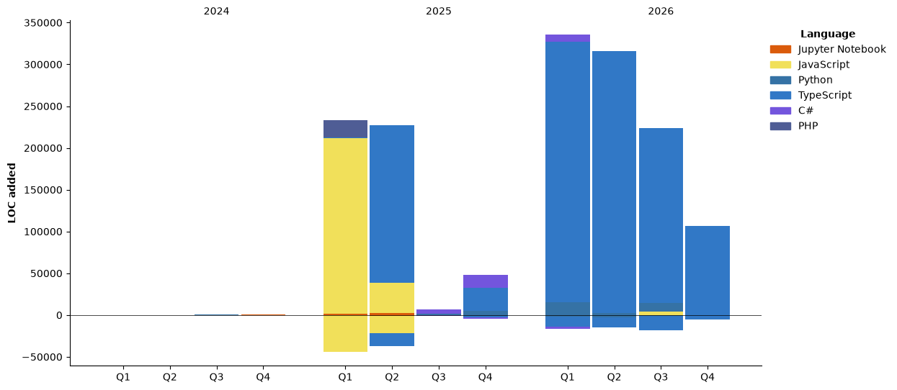

<p align="center">
  
</p>

<h2> Akwaba 👋🏾, I'm Mamadou Coulibaly! </h2>

<p><em>Software Engineer · GIS Specialist · AI Engineer — Programmer Analyst at the <a href="https://www.regina.ca">City of Regina</a>

</em></p>

[](https://www.linkedin.com/in/tiefin-mamadou-coulibaly/)


I build **AI-powered geospatial applications** — full-stack web mapping, spatial databases, and local-first AI tools that solve real day-to-day problems for GIS professionals.

###  A little more about me...

```javascript
const mamadou = {
  name: "Mamadou Tiefin Coulibaly",
  basedIn: "Regina, Saskatchewan, Canada 🇨🇦",
  from: "Côte d'Ivoire 🇨🇮",
  spokenLanguages: ["French", "English"],
  education: "Master's in Geomatics",
  codeLanguages: ["TypeScript", "JavaScript", "Python", "SQL"],

  askMeAbout: [
    "AI-powered GIS applications",
    "web mapping",
    "spatial databases & PostGIS",
    "RAG pipelines",
    "geoprocessing automation",
    "municipal asset data management"
  ],

  technologies: {
    frontend: {
      frameworks: ["Next.js", "React"],
      styling: ["Tailwind CSS", "Sass", "Bootstrap"],
      mapping: ["MapLibre GL", "ArcGIS Maps SDK for JavaScript"]
    },

    backend: {
      node: ["Node.js", "Express", "NestJS"],
      python: ["FastAPI"],
      orm: ["Prisma"]
    },

    gis: {
      esri: [
        "ArcGIS Enterprise",
        "ArcGIS Pro",
        "ArcGIS Online",
        "Field Maps",
        "Experience Builder"
      ],
      openSource: ["QGIS", "PostGIS", "GeoServer", "Shapely", "Rasterio"],
      etl: ["FME Workbench", "FME Flow", "arcpy"]
    },

    databases: {
      spatial: ["PostgreSQL/PostGIS", "Oracle SDE"],
      relational: ["MySQL"],
      nosql: ["MongoDB"],
      platforms: ["Supabase"]
    },

    ai: {
      frameworks: ["LangChain"],
      patterns: ["RAG", "text-to-SQL", "AI agents"],
      runtime: ["Ollama", "ONNX Runtime"],
      geoAI: ["SAM-Geo"]
    },

    devOps: {
      tools: ["Docker", "Git", "GitHub Actions", "Jenkins"],
      hosting: ["Vercel", "Netlify", "Hetzner"]
    }
  },

  currentFocus: "Local-first, open-source AI tools for GIS professionals",
  funFact: "From Bouaké to Regina: same love for maps, about 50°C colder"
};
```

 <em><b>I love connecting with GIS and AI people</b> — if you want to say <b>hi, I'll be happy to meet you!</b> 😊</em>

---
<!--START_SECTION:waka-->


**🐱 My GitHub Data** 

> 📦 140.5 kB Used in GitHub's Storage 
 > 
> 🏆 538 Contributions in the Year 2026
 > 
> 🚫 Not Opted to Hire
 > 
> 📜 10 Public Repositories 
 > 
> 🔑 76 Private Repositories 
 > 
**I'm an Early 🐤** 

```text
🌞 Morning                520 commits         ███████░░░░░░░░░░░░░░░░░░   28.43 % 
🌆 Daytime                535 commits         ███████░░░░░░░░░░░░░░░░░░   29.25 % 
🌃 Evening                655 commits         █████████░░░░░░░░░░░░░░░░   35.81 % 
🌙 Night                  119 commits         ██░░░░░░░░░░░░░░░░░░░░░░░   06.51 % 
```
📅 **I'm Most Productive on Thursday** 

```text
Monday                   244 commits         ███░░░░░░░░░░░░░░░░░░░░░░   13.34 % 
Tuesday                  277 commits         ████░░░░░░░░░░░░░░░░░░░░░   15.14 % 
Wednesday                273 commits         ████░░░░░░░░░░░░░░░░░░░░░   14.93 % 
Thursday                 293 commits         ████░░░░░░░░░░░░░░░░░░░░░   16.02 % 
Friday                   259 commits         ████░░░░░░░░░░░░░░░░░░░░░   14.16 % 
Saturday                 238 commits         ███░░░░░░░░░░░░░░░░░░░░░░   13.01 % 
Sunday                   245 commits         ███░░░░░░░░░░░░░░░░░░░░░░   13.40 % 
```


📊 **This Week I Spent My Time On** 

```text
🕑︎ Time Zone: America/Regina

💬 Programming Languages: 
YAML                     2 hrs 48 mins       ███████████████░░░░░░░░░░   59.53 % 
JSON                     1 hr 9 mins         ██████░░░░░░░░░░░░░░░░░░░   24.71 % 
Markdown                 8 mins              █░░░░░░░░░░░░░░░░░░░░░░░░   03.06 % 
TypeScript               7 mins              █░░░░░░░░░░░░░░░░░░░░░░░░   02.69 % 
JavaScript               7 mins              █░░░░░░░░░░░░░░░░░░░░░░░░   02.64 % 

🔥 Editors: 
WebStorm                 4 hrs 7 mins        ██████████████████████░░░   87.30 % 
Claude Code              26 mins             ██░░░░░░░░░░░░░░░░░░░░░░░   09.47 % 
PyCharm                  9 mins              █░░░░░░░░░░░░░░░░░░░░░░░░   03.23 % 

🐱‍💻 Projects: 
conformer                4 hrs 16 mins       ███████████████████████░░   90.67 % 
san-pedro-digitalization-17 mins             ██░░░░░░░░░░░░░░░░░░░░░░░   06.11 % 
feature_class_creator    9 mins              █░░░░░░░░░░░░░░░░░░░░░░░░   03.23 % 

💻 Operating System: 
Windows                  4 hrs 42 mins       █████████████████████████   100.00 % 
```

🤖 **AI Coding This Week** 

```text
⏱ AI Coding Time: 34 mins (12.07%)

✍️ 928 lines written by AI, 26 lines written by hand (97.27% AI-written)

🔤 201,982 Input Tokens, 27,098 Output Tokens

💵 $2.59 Estimated AI Cost This Week

🧠 2 AI Sessions, 14 AI Prompts

Opus                     928 lines           █████████████████████████   100.00 % 

🔎 AI Coding Insights:
🤖 AI-Driven — 97.27% of written lines came from AI
📚 Verbose Prompter — average 2,290 characters per prompt
🔁 Iterative Prompter — average 7 prompts per session
🚀 High AI Trust — 2.83% of changed lines were hand-edited
```

**I Mostly Code in Python** 

```text
Python                   49 repos            ████████████████░░░░░░░░░   62.03 % 
TypeScript               16 repos            █████░░░░░░░░░░░░░░░░░░░░   20.25 % 
JavaScript               6 repos             ██░░░░░░░░░░░░░░░░░░░░░░░   07.59 % 
Jupyter Notebook         5 repos             ██░░░░░░░░░░░░░░░░░░░░░░░   06.33 % 
C#                       2 repos             █░░░░░░░░░░░░░░░░░░░░░░░░   02.53 % 
```


**Timeline**




 Last Updated on 27/11/2026 16:32:43 UTC
<!--END_SECTION:waka-->
